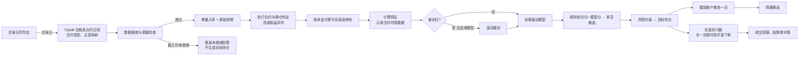

# 国内商品期货多空轮动（TqSdk 回测与实盘）—— 设计书

> 本文件是期货子项目的设计书，只描述规格，不记录过程。取舍与实测结论写入 `docs/decisions.md`（期货条目以 `[future]` 开头）。
> 方法论继承 `docs/design.txt`（A 股 ETF 轮动设计书，下称“ETF 设计”）：按时点数据、滚动重训、预登记轮次、试验登记、只检验一次的最终检验窗口、影子期运行核对、三条红线。本文件只写期货版本的规格与差异；未写到的工程规范（代码风格、日志、Git、测试纪律）沿用 ETF 设计 §14。
> 标注“待实测”的接口与数值由 §23 的探测脚本确认后回填本文件。文中出现的价格、保证金、波动数值凡注明“示例”的，只用于说明计算方法，不是行情，也不进入配置。

## 1. 一句话描述与边界

每个期货交易日日盘收盘后，程序通过 TqSdk 拉取国内商品期货各合约日线，按自定的移仓规则得到每个品种的“执行合约”与连续收益序列，计算只用当时已知信息的特征（时序动量、截面动量、期限结构、基差动量、持仓量、波动与市场状态），给每个品种打分，在“两万元本金下交易得起”的品种中选出做多与做空的候选，经过保证金、单笔风险、名义杠杆、相关性与账户回撤约束后，生成下一交易日开盘的目标持仓。回测模块按与实盘完全相同的规则，以两万元资金、整手、逐笔计手续费与滑点、逐日盯市、涨跌停不可成交、移仓换月的方式在历史上逐日重放；实盘由同一套目标持仓通过 TqSdk 的 `TargetPosTask` 下单。

边界：

- 交易标的：上期所、大商所、郑商所的商品期货。上期能源（INE）与广期所（GFEX）品种需单独开通交易权限，默认排除，核实开户权限后可通过配置加入；股指期货、国债期货、期权不做（保证金与适当性门槛超出两万元本金，见 §4.4）。
- 只做日频决策：信号在交易日 t 日盘收盘（15:00）后产生，最早在 t+1 交易日的第一个交易时段开盘执行（有夜盘的品种为 t 日 21:00 夜盘开盘）。不做日内交易，不做高频，不使用拿不到长历史的分钟数据做研究。
- 只做现实可执行的方案：依赖“收盘前已知收盘价”、拿不到的历史分钟或 tick 数据、或两万元下无法整手成交的方案不进入规格。
- 实盘前必须依次通过：研究达标 → 最终检验 → 快期模拟账户影子期 → 小仓实盘期（§16）。任何一步未通过不得进入下一步。
- 推送与报告内容不构成投资建议。期货有杠杆，亏损可以超过保证金；本金可能在短时间内大幅亏损，这一点在 §4、§13、§22 中逐项量化。

## 2. 与 ETF 设计的继承与差异

| 项目       | ETF 设计（design.txt）  | 本设计（期货）                                                                  | 原因                                                        |
| :--------- | :---------------------- | :------------------------------------------------------------------------------ | :---------------------------------------------------------- |
| 方向       | 只做多                  | 多空双向                                                                        | 期货卖开无借券成本，空头与多头对称                          |
| 资金占用   | 全额                    | 保证金（约名义价值的 10%~20%）                                                  | 杠杆；需要保证金、风险度与强平约束（§13）                   |
| 持仓粒度   | 100 份，约几十元一手    | 1 手，名义价值约 2~5 万元                                                       | 两万元只能持 1~3 手，仓位只能是 0 或 1 手（§4.3）           |
| 标的连续性 | ETF 长期存续            | 合约会到期，必须移仓                                                            | 自定执行合约与移仓规则，连续收益按持有合约拼接（§8.4）      |
| 基准       | 沪深 300                | 绝对收益（相对现金 0），对照多头等权商品组合                                    | 多空组合没有自然的市场基准                                  |
| 预测目标   | 跑赢截面中位数          | 波动标准化后的远期收益跑赢截面中位数；方向另由时序动量门控                      | 多空都需要排序；方向信息来自时序动量（§9、§12）             |
| 主方案     | LightGBM                | 规则因子综合分为主方案，LightGBM 为挑战者                                       | 品种只有 15~25 个、历史约 10 年，机器学习样本少，需先有基线 |
| 成本       | 佣金（最低 5 元）+ 滑点 | 交易所手续费 × 期货公司加收 + 滑点（按最小变动价位）+ 平今手续费 + 移仓双边成本 | 期货收费按手或按成交额，部分品种平今收费不同                |
| 成交约束   | 涨停不买、跌停不卖      | 涨停不能买开/买平，跌停不能卖开/卖平；一字板全天无法成交                        | 空头在涨停时无法平仓，风险对称                              |
| 盯市       | 无                      | 逐日盯市，浮亏当日从权益中扣除                                                  | 保证金不足时期货公司强平                                    |
| 交易日     | 自然日即交易日          | 交易日从前一晚 21:00 夜盘开始                                                   | 时间主键与信号时点按交易日定义（§7）                        |
| 实盘       | 不下单                  | TqSdk 下单，分阶段上线                                                          | 用户要求后期实盘                                            |
| 红线       | 三条                    | 四条（新增“实盘风控”）                                                          | 下单程序出错的后果是真实亏损（§20）                         |

## 3. 期货特性与对设计的影响

| 特性                 | 对设计的要求                                                                                                                                 | 章节      |
| :------------------- | :------------------------------------------------------------------------------------------------------------------------------------------- | :-------- |
| 可以做空             | 选择函数同时输出多头与空头候选；空头与多头使用同一套风险约束；不设“只做多”的隐含假设                                                         | §12、§13  |
| 杠杆                 | 名义价值、保证金、单笔风险分别设上限；回测逐日计算风险度并模拟强平                                                                           | §13、§14  |
| 保证金会变           | 交易所在长假前、连续涨跌停、品种风险加大时上调保证金；期货公司在交易所标准上再加收。回测用“交易所标准 + 期货公司加收 + 长假上调”的保守口径   | §8.6、§14 |
| 合约到期             | 每个品种只持一个执行合约；按持仓量与自然人交割月限制移仓；移仓是两笔真实成交，计成本                                                         | §8.4、§14 |
| 自然人不能进入交割月 | 执行合约必须在交割月前一个月的倒数第 `roll.exit_buffer_days` 个交易日之前平仓或移仓（期货公司通常要求更早，按开户期货公司规定核实）          | §8.4      |
| 涨跌停与一字板       | 涨停时空头无法平仓、跌停时多头无法平仓；连续一字板的亏损可以远超止损距离。用“单边一个涨跌停的压力亏损”约束组合                               | §13.4     |
| 夜盘                 | 交易日 t 的夜盘在自然日 t−1 的 21:00 开始；日线开盘价就是夜盘开盘价。长假前最后一个交易日之后没有夜盘                                        | §7        |
| 结算价               | 期货公司按结算价（当日成交量加权均价，各交易所口径略有不同）盯市，不按收盘价。TqSdk 日线不含结算价，回测用收盘价近似，列为已知偏差           | §14、§22  |
| T+0、无印花税        | 可以当日开平；平今手续费部分品种高于平昨。本设计持有期 ≥ 1 个交易日，平今只在止损当日触发                                                    | §14.4     |
| 各交易所规则不同     | 郑商所合约代码为大写字母加 3 位数字；手续费有按手与按成交额两种；上期所区分平今平昨报单。下单统一用 `TargetPosTask`，由 TqSdk 处理平今平昨   | §8、§16   |
| 品种上市与淡出       | 新品种不断上市（如纯碱、尿素、短纤），部分老品种已无流动性（如线材、早籼稻、强麦、动力煤）。品种池按时点确定，不用今天的活跃品种列表回测过去 | §8.3      |

## 4. 两万元本金下的交易范围

本节决定“交易得起什么”。所有门槛按 t 日的账户权益 `equity(t)` 计算，所以权益上升后可交易范围自动变大，权益下降后自动变小。

### 4.1 单手指标

对品种 p 在 t 日的执行合约 c：

- 单手名义价值：`notional(p,t) = C_c(t) × mult_p`，`mult_p` 为合约乘数（`quote.volume_multiple`）。
- 单手保证金：`margin_lot(p,t) = notional(p,t) × (exch_margin_rate(p,t) + broker_margin_add)`；长假前最后 `holiday.margin_bump_days` 个交易日另加 `holiday.margin_bump`（§8.6）。
- 单手波动：`atr_lot(p,t) = ATR20_c(t) × mult_p`，ATR20 为执行合约连续序列的 20 日真实波幅均值（§10.6）。
- 单手止损风险：`risk_lot(p,t) = risk.stop_atr_k × atr_lot(p,t) + 2 × slippage_ticks × price_tick_p × mult_p`。
- 单手涨跌停压力亏损：`limit_loss_lot(p,t) = notional(p,t) × limit_pct(p,t)`，`limit_pct` 为该品种当时的涨跌停幅度（§8.6）。

### 4.2 品种入选门槛（全部满足）

| 编号 | 条件                                                                                          | 默认值（两万元时的绝对额） | 配置键                                         |
| :--- | :-------------------------------------------------------------------------------------------- | :------------------------- | :--------------------------------------------- |
| G1   | `margin_lot ≤ universe.max_margin_lot_frac × equity`                                          | 0.25（5,000 元）           | `universe.max_margin_lot_frac`                 |
| G2   | `risk_lot ≤ risk.risk_per_trade × equity`                                                     | 0.04（800 元）             | `risk.risk_per_trade`                          |
| G3   | `notional ≤ risk.max_notional_lot_mult × equity`                                              | 2.5（50,000 元）           | `risk.max_notional_lot_mult`                   |
| G4   | 执行合约近 20 日日均成交量 ≥ `min_avg_volume` 手，且品种总持仓量 ≥ `min_open_interest` 手     | 50,000 手 / 50,000 手      | `universe.min_avg_volume`、`min_open_interest` |
| G5   | 品种首个合约上市已满 `min_listed_days` 个交易日                                               | 250                        | `universe.min_listed_days`                     |
| G6   | 交易所属于 `universe.exchanges`（默认 SHFE、DCE、CZCE），品种不在 `universe.exclude_products` | 见 §18                     | `universe.exchanges`                           |

- G1~G3 每日重算，用 t 日收盘数据；某品种在持仓期间不再满足 G1~G3，不强制平仓，但不再加仓，到下次调仓按规则处理（避免因保证金调整被动来回交易）。
- G2 是两万元下最紧的一条：仓位只能取整手，不能把一手“缩小”，所以单手风险超过预算的品种只能不做，而不是做“半手”。
- 入选品种少于 `universe.min_pool_size`（默认 6）的日期不交易，持仓按规则自然退出。

### 4.3 两万元下的仓位结构

- 每个品种的手数：`lots = floor(risk.risk_per_trade × equity / risk_lot)`，结果为 0 时不交易该品种，结果上限为 `risk.max_lots_per_product`（默认 3）。两万元时绝大多数可选品种 `lots = 1`。
- 同时持仓品种数 ≤ `portfolio.max_positions`（默认 2，研究中在 {1, 2} 中选定，§15.4 R6）。
- 多空结构 `portfolio.structure`：`long_short`（最多 1 多 1 空）或 `free`（方向不限，总数 ≤ `max_positions`），研究中选定（R6）。
- 组合约束（全部满足才能新开仓，按开仓后状态计算）：
  - 保证金占用（风险度）`Σ margin_lot × lots ≤ risk.max_margin_usage × equity`，默认 0.50（10,000 元）；
  - 总名义价值 `Σ notional × lots ≤ risk.max_gross_notional_mult × equity`，默认 4.0（80,000 元）；
  - 总止损风险 `Σ risk_lot × lots ≤ risk.max_total_risk × equity`，默认 0.08（1,600 元）；
  - 涨跌停压力亏损 `Σ limit_loss_lot × lots ≤ risk.max_limit_loss × equity`，默认 0.25（5,000 元）。该项按所有持仓同时遭遇一个不利停板计算，不考虑多空对冲。
- 这些上限是固定风险参数，不参与调参；§14.6 的情景 `risk_loose` 与 `risk_tight` 只报告敏感性。

### 4.4 预计范围（示例计算，非行情）

下表的价格、保证金率与 ATR 都是说明用的假设值，真实入选由程序按 §4.2 每日计算并写入 `artifacts/universe/pool_{YYYY-MM-DD}.parquet`。环境准备完成后，程序按实测数据生成同结构的表格写入 `docs/research/SETUP_DONE.md`。

| 品种（示例） | 假设价格 | 乘数 | 假设保证金率 | 单手保证金 | 假设 ATR20 | 单手止损风险（2 ATR） | 两万元时 |
| :----------- | -------: | ---: | -----------: | ---------: | ---------: | --------------------: | :------- |
| 玉米 c       |    2,300 |   10 |          12% |      2,760 |         18 |                   360 | 可选     |
| 豆粕 m       |    2,900 |   10 |          12% |      3,480 |         30 |                   600 | 可选     |
| 甲醇 MA      |    2,400 |   10 |          12% |      2,880 |         35 |                   700 | 可选     |
| PTA TA       |    4,800 |    5 |          12% |      2,880 |         60 |                   600 | 可选     |
| 螺纹钢 rb    |    3,200 |   10 |          12% |      3,840 |         45 |                   900 | 超出 G2  |
| 纯碱 SA      |    1,400 |   20 |          14% |      3,920 |         40 |                 1,600 | 超出 G2  |
| 铁矿石 i     |      780 |  100 |          15% |     11,700 |         20 |                 4,000 | 超出 G1  |
| 棕榈油 p     |    9,000 |   10 |          12% |     10,800 |        150 |                 3,000 | 超出 G1  |
| 沪铜 cu      |   78,000 |    5 |          12% |     46,800 |        900 |                 9,000 | 超出 G1  |

由此得出的范围特征（规则层面的结论，不依赖示例数值）：

- 两万元能交易的是单手名义价值约 3 万元以内、波动较低的品种，集中在农产品（玉米、玉米淀粉、豆粕、菜粕、鸡蛋等）、能化（甲醇、PTA、乙二醇、短纤、PP、塑料、PVC、尿素、燃料油、沥青等）与部分建材黑色（螺纹钢、热卷、玻璃、硅铁、锰硅，视当时波动是否满足 G2）。
- 基本排除：有色金属（铜、镍、锡等单手保证金 3 万元以上）、贵金属、铁矿石、焦煤焦炭、油脂（视价格）、生猪、橡胶、股指与国债期货、原油。
- 预计每日入选 8~18 个品种（待实测）；品种少意味着截面信息有限，这是本设计采用规则基线优先、严格控制试验数的原因之一。
- 研究报告给出“本金敏感性”诊断：同一策略在 2 万、5 万、10 万元下的入选品种数、未执行信号比例与净值（情景 `capital_50k`、`capital_100k`），用于判断小资金本身造成的损耗。

## 5. 端到端流程



每日时序（北京时间；具体时刻由 §23 发布时刻观测核定）：

| 时刻               | 动作                                                                                      |
| :----------------- | :---------------------------------------------------------------------------------------- |
| 15:30              | 首次拉取 t 日日线与合约信息                                                               |
| 15:30~19:30        | 未就绪时每 `schedule.retry_minutes`（默认 15）分钟重试                                    |
| 19:30              | 仍未就绪：推送告警，当日不生成新目标持仓；已有持仓维持，止损监控照常                      |
| 就绪后             | 移仓判定 → 品种池 → 特征 →（重训）→ 打分 → 目标持仓 → 模拟账户 → 推送，目标 20 分钟内完成 |
| 20:50              | 实盘执行器启动，加载目标持仓，核对账户                                                    |
| 21:00 / 次日 09:00 | 有夜盘品种在夜盘开盘执行，无夜盘品种（或当晚无夜盘）在日盘开盘执行                        |
| 各交易时段         | 保护性止损监控（§13.3），只在执行器运行时有效                                             |

## 6. 关键决策速查

| 项目     | 决策                                                                                              | 详见     |
| :------- | :------------------------------------------------------------------------------------------------ | :------- |
| 平台     | fork `shinnytech/tqsdk-python`，锁定提交；策略代码放独立包 `cnfut`，不改 TqSdk 核心               | §19.1    |
| 标的     | SHFE、DCE、CZCE 商品期货，按 §4 的本金门槛按时点筛选                                              | §4       |
| 执行合约 | 自定规则：持仓量最大、距自然人交割月限制足够远、只向远月切换；TqSdk 主连映射只做核对              | §8.4     |
| 信号     | 规则综合分（时序动量、截面动量、期限结构、基差动量）为主；LightGBM 为挑战者，须胜过规则基线才采用 | §12      |
| 方向     | 综合分高且时序动量为正做多；综合分低且时序动量为负做空；其余不做                                  | §12.3    |
| 仓位     | 整手；单笔风险 ≤ 4% 权益；两万元时通常每品种 1 手，最多 2 个品种                                  | §4.3     |
| 风控     | 保证金占用 ≤ 50%、总名义 ≤ 4 倍、总止损风险 ≤ 8%、停板压力 ≤ 25%；保护性止损 3 ATR；账户回撤熔断  | §13      |
| 回测     | 自研日频引擎（研究、选参用）+ TqBacktest 对账回放（冻结候选用），两者交易记录必须一致             | §14      |
| 验证     | 研究期滚动样本外 6 折 → 只检验一次的最终检验窗口 → 快期模拟 12 周 → 小仓实盘 8 周                 | §15、§16 |
| 指标     | 年化净收益、夏普、最大回撤、Calmar、最差月份，按 2 万元实际权益计算                               | §14.8    |
| 实盘     | `TqAccount` + `TargetPosTask`；目标持仓幂等；本地风控规则 `TqRiskRule`；每日结算单对账            | §16      |
| 红线     | 四条：数据真实、结果真实、凭据安全、实盘风控                                                      | §20      |

## 7. 时间、日历与约定

### 7.1 交易日

- 时间主键 `trade_date`：期货交易日（`datetime.date`），存储为 parquet `date32`。交易日 t 包含自然日 t−1（或前一个交易日）21:00 开始的夜盘与 t 日的日盘。
- 交易日序号 `td_idx`：基于交易日历的整数序号，所有“第 t+k 个交易日”的计算基于 `td_idx`。
- TqSdk 日线的 `datetime` 字段为该交易日起点的纳秒时间戳，入库时换算为 `trade_date`，换算规则由 §23 实测确认后固定，并有测试覆盖（夜盘、周五夜盘对应下周一交易日、长假前无夜盘三种情形）。
- 运行日志、下单、成交、推送记录中的时刻一律 UTC 毫秒（`*_ms`）。禁止 naive `datetime`。

### 7.2 交易日历

- 来源：`api.get_trading_calendar(start_dt, end_dt)`，本地存 `data/calendar/trade_dates.parquet`，字段 `date`、`trading`、`has_night`、`source`。
- `has_night`：该交易日是否有夜盘。长假前最后一个交易日之后的那个交易日没有夜盘（交易所公告）；由程序根据日历判断“前一个交易日与本交易日之间是否跨越非周末的休市日”，并与实测日线的夜盘成交核对，不一致时抛 `CalendarError`。
- 需要的日期超出已知日历末端时抛 `CalendarError`，不按工作日推断。日历末端距今不足 30 个交易日时，简报末尾提示。
- 长假：前后两个交易日之间自然日间隔 ≥ `holiday.long_gap_days`（默认 4，即普通周末之外至少多休 1 天）的称为长假，用于保证金上调与长假前规则（§13.5）。

### 7.3 信号与执行时点

- 信号时点：t 日 15:00 日盘收盘后，数据就绪即可计算。只使用 t 日及以前交易日的完整日线。
- 执行时点：t+1 交易日的第一个交易时段开盘，即日线的 `open`。有夜盘的品种为 t 日 21:00，没有夜盘的品种或 t+1 当日无夜盘时为 t+1 日 09:00（中间可能跨越长假）。
- 方案 B（§14.5）在 t+1 日盘收盘前执行，回测用 t+1 日 `close` 近似。

## 8. 数据层

### 8.1 数据源

| 数据               | 接口（TqSdk）                                                               | 用途                                 | 状态                     |
| :----------------- | :-------------------------------------------------------------------------- | :----------------------------------- | :----------------------- |
| 合约列表           | `api.query_quotes(ins_class="FUTURE", exchange_id=..., expired=True/False)` | 全部在市与已下市合约                 | 已下市合约覆盖范围待实测 |
| 合约信息           | `api.query_symbol_info(...)` / `api.get_quote(...)`                         | 乘数、最小变动价位、到期日、交割年月 | 待实测                   |
| 合约日线           | `api.get_kline_serial(symbol, 86400, data_length=8000)`                     | 行情、持仓量、执行合约与期限结构     | 每个序列最多 8000 根     |
| 主连映射           | `api.query_his_cont_quotes(symbol="KQ.m@...", n=...)`                       | 只做执行合约规则的核对               | 最大 n 待实测            |
| 品种指数           | `KQ.i@交易所.品种` 日线                                                     | 只做数据交叉核对与市场状态备用       | 待实测                   |
| 交易日历           | `api.get_trading_calendar(...)`                                             | §7.2                                 | 待实测                   |
| 当前保证金与手续费 | `quote.margin`、`quote.commission`                                          | 当前费率快照；历史费率见 §8.6        | 只代表当前值             |
| 结算单             | `api.get_settlement_info(trading_day)`                                      | 实盘对账（§16.5）                    | 实盘阶段                 |
| 交叉核对（可选）   | AKShare 交易所日线（如 `get_futures_daily`）                                | 异常数据核对、结算价对照             | 可选，待实测             |

规则：

- 历史数据批量下载的 `DataDownloader` 是 TqSdk 专业版功能，本设计不依赖它；免费账户用 `get_kline_serial` 逐合约取日线（日线 8000 根约 33 年，足够）。若实测发现免费账户取不到已下市合约的历史，研究期改为“可取到的最早连续区间”，并在 §15.1 回填区间。
- TqSdk 回测（`TqBacktest`）与免费版的可用范围（并发、次数、可回测起点）待实测；不可用时对账回放（§14.9）改用快期模拟账户的影子期记录代替，并写入 `decisions.md`。
- 所有 TqSdk 调用经 `cnfut.data.fetch` 统一发出：单个 `TqApi` 实例、串行请求、单次超时 `data.request_timeout_s`（默认 60 秒）、失败重试 `data.request_retries`（默认 3）次；重试耗尽抛出带合约代码与参数的异常。
- 只追加新交易日；已入库数值与新返回值相对差 > `1e-9` 时写入 `data/revisions/{YYYY-MM-DD}.json` 并在推送中提示，入库数据不自动覆盖。
- TqSdk 版本锁定在 fork 的提交哈希；升级须重跑数据契约测试，并对研究期全部入库数据逐值比对新旧返回。

### 8.2 合约与品种主数据

- `data/meta/contracts.parquet`：`symbol`、`exchange`、`product_id`、`delivery_year`、`delivery_month`、`list_date`、`expire_date`、`last_hold_date_individual`（自然人最后持仓日，§8.4）、`volume_multiple`、`price_tick`、`source`、`fetched_ms`。
- `data/meta/products.parquet`：`product_id`、`exchange`、`name`、`sector`（`ferrous` 黑色建材、`energy_chem` 能化、`agri` 农产品、`nonferrous` 有色、`precious` 贵金属、`financial` 金融）、`first_list_date`、`night_session`（按时点区间记录，品种开通夜盘的日期不同）、`fee_type`（按手 / 按成交额）。
- `sector` 只用于相关性约束与报告分组，由配置 `universe.sectors` 冻结。

### 8.3 按时点品种池

t 日品种池 = 满足 §4.2 G4~G6 的品种（“流动性池”，与本金无关，用于计算截面特征与标签），其中再满足 G1~G3 的为“可交易池”（与本金有关，只用于选择）。

- 截面特征、截面标签、Rank IC 在流动性池上计算；选择只在可交易池中进行。这样模型学到的是全部活跃品种的相对强弱，本金只决定“做哪些”。
- 流动性池少于 `universe.min_liquid_pool`（默认 12）的日期不产生训练样本。
- 每日池子写入 `artifacts/universe/pool_{YYYY-MM-DD}.parquet`，含每个品种的 G1~G6 判定值。

### 8.4 执行合约与移仓

每个品种在每个交易日有且只有一个执行合约，规则（只用 ≤ t 的数据）：

1. 合格合约：t 日在市、`td_idx(last_hold_date_individual) − td_idx(t) > roll.exit_buffer_days`（默认 5）的合约。
   - `last_hold_date_individual`：交割月前一个月的最后一个交易日（交易所对自然人的一般规定）；配置 `roll.individual_rule` 允许按开户期货公司的更早要求整体提前 `roll.broker_extra_days`（默认 0，使用者核实后填写）。
2. 候选：合格合约中 t 日收盘持仓量最大者，并列时取交割月更远者。
3. 切换：候选与当前执行合约不同，且候选交割月更远，且（候选持仓量 > 当前执行合约持仓量 × `roll.oi_switch_ratio`（默认 1.0）连续 `roll.confirm_days`（默认 1）个交易日，或当前执行合约已不合格）时，t+1 起执行合约改为候选。
4. 只向远月切换，不切回近月。
5. 持仓中的移仓：t 日收盘判定切换后，t+1 开盘平旧合约、开新合约（两笔成交，各自计成本与涨跌停约束）；旧合约平仓受阻（跌停或涨停锁死）时保留旧仓，次一交易时段重试，新合约开仓照常但组合约束按两腿同时存在计算，不满足则新合约暂不开仓。
6. 核对：执行合约序列与 `query_his_cont_quotes` 返回的主连映射逐日比较，一致率写入报告；不一致不报错（规则不同是预期的），但一致率 < 80% 时在报告中列出原因。

连续收益序列（用于特征与标签，不做价格拼接）：

- 日收益 `r_p(t) = C_{c(t)}(t) / C_{c(t)}(t−1) − 1`，其中 `c(t)` 是 t 日的执行合约，分子分母都用同一个合约的价格。切换日用新合约自身的前收盘，所以换月价差不进入收益。
- 开盘口径收益同理用同一合约的 `O`。
- 连续价格指数 `P_p(t) = Π (1 + r_p(s))`，起点为 1；用于动量、波动、ATR 等需要价格水平的特征。ATR 中的真实波幅用当日执行合约的 H、L 与同一合约的前收盘计算，再除以该合约前收盘得到比例，乘以当日执行合约收盘价换回点数。
- 禁止用 TqSdk 主连（`KQ.m@`）日线直接计算收益：主连换月时价格跳空，会制造虚假收益。

### 8.5 存储

```text
data/
  calendar/trade_dates.parquet            date, trading, has_night, source
  meta/contracts.parquet                  合约主数据
  meta/products.parquet                   品种主数据
  bars/{exchange}/{product}/{symbol}.parquet  trade_date, open, high, low, close, volume, open_oi, close_oi, source, fetched_ms
  cont/{product}.parquet                  trade_date, exec_symbol, next_symbol, r_close, r_open, P, atr20_pts, roll_flag
  rates/margin.yaml                       交易所保证金率与涨跌停幅度的历史区间（§8.6）
  rates/fees.yaml                         交易所手续费标准的历史区间（§8.6）
  raw/{YYYY-MM-DD}/{symbol}.json.gz       原始返回，保留 raw_keep_days（默认 30）天
  revisions/{YYYY-MM-DD}.json             历史修订记录
  masks.yaml                              交叉核对不一致的不可用区间（程序写入）
  manifest.json                           每个文件首末日期、行数、SHA256
artifacts/
  universe/pool_{YYYY-MM-DD}.parquet      当日流动性池、可交易池与门槛判定
  features/{YYYY-MM-DD}.parquet           当日特征截面
  models/{model}/{train_end}.txt|.json    LightGBM 模型与元数据（启用时）
  predictions/predictions.parquet         每日打分记录（只追加）
  paper/                                  模拟账户状态与逐日目标持仓
  live/                                   实盘目标持仓、委托、成交、对账（§16）
  backtest/{run_id}/                      回测输出（§14.7）
  reports/                                研究、最终检验报告与 EXPERIMENTS.log
  logs/{YYYY-MM}.log                      结构化日志
```

- `data/` 与 `artifacts/` 不进入 git。`artifacts/live/` 另每日备份到 `%USERPROFILE%\cnfut_backup\live\`。

### 8.6 保证金率、涨跌停幅度与手续费的历史口径

TqSdk 的 `quote.margin`、`quote.commission` 只给当前值，不能代表历史。回测采用：

- 交易所保证金率与涨跌停幅度：`data/rates/margin.yaml` 按品种记录区间值 `{product: [{from, to, margin_rate, limit_pct, source}]}`，来源为交易所公告。环境准备阶段先按“当前交易所标准”填写一条覆盖全期的记录，`source: current_snapshot`，并标为已知偏差（§22）；之后可按公告补充历史区间。
- 回测保证金率 = 交易所保证金率 + `broker_margin_add`（默认 0.04，使用者开户后按期货公司实际加收核实）。长假前 `holiday.margin_bump_days`（默认 2）个交易日起，另加 `holiday.margin_bump`（默认 0.03）。
- 手续费：`data/rates/fees.yaml` 记录交易所标准（开仓、平昨、平今，按手或按成交额），回测手续费 = 交易所标准 × `cost.broker_fee_mult`（默认 2.0，保守值，使用者从交割单核实后在研究第一轮开始前改为实际值，研究开始后不得修改）。
- 每次研究运行把所用费率文件的 SHA256 写入 `config.yaml` 快照。

### 8.7 质量检查

入库前逐项检查，失败抛出带合约与日期的 `DataQualityError`：

1. 日期严格递增、无重复、都在交易日历中；合约在 `list_date ~ expire_date` 之间的交易日不得缺失（无成交日 TqSdk 的返回方式待实测，按实测规则处理并有测试）。
2. `low ≤ min(open, close) ≤ max(open, close) ≤ high`，价格 > 0，成交量与持仓量 ≥ 0。
3. 单日涨跌幅绝对值 > 当时涨跌停幅度 + `data.limit_tol`（默认 0.005）时进入交叉核对：用 AKShare 交易所日线或 `KQ.i@` 品种指数核对；一致时放行，无第二来源或不一致时写入 `data/masks.yaml`，对应样本不进入训练、打分与选择。
4. 就绪判定：t 日流动性池中全部品种的执行合约与次远合约的最新 `trade_date` 等于 t。

## 9. 标签

记 `r_p` 为 §8.4 的连续收益，`H = label.horizon`。

- 主标签（开盘口径）：`R_p(t) = Π_{s=t+1}^{t+H} (1 + r^open_p(s)) − 1`，即 t+1 开盘进、t+1+H 开盘出，换月按 §8.4 拼接。
- 波动标准化：`Z_p(t) = R_p(t) / (σ60_p(t) × √H)`，`σ60` 为截至 t 的 60 日日收益标准差。期货品种波动差异很大，不标准化时截面排序会被高波动品种主导。
- 截面标签：`y_p(t) = 1{Z_p(t) > med_t}`，`med_t` 为 t 日流动性池 `Z` 的中位数；等于中位数记 0。
- 截面分位标签：`q_p(t)` 为 `Z_p(t)` 的截面百分位；`g_p(t) = min(⌊5 q_p(t)⌋, 4)`。
- 方向标签（只用于诊断与时序动量门控的检验）：`d_p(t) = sign(R_p(t))`。
- 标签结束时刻视为 t+1+H 日收盘后才可用于训练。
- `H ∈ label.horizon_grid`（默认 {5, 10, 20}），研究中选定（R3）。
- 收盘口径（方案 B 用）：t+1 收盘进、t+1+H 收盘出，其余同上。

## 10. 特征

所有特征在 t 日只使用 t 日及以前的数据，窗口长度来自配置 `features`。`r_p` 为连续日收益，`P_p` 为连续价格指数，`ln` 为自然对数。

### 10.1 时序动量（`tsm_*`）

- `tsm_ret_{L}`：`ln P_p(t) − ln P_p(t−L)`，`L ∈ tsm_windows`（默认 {20, 60, 120, 250}）。
- `tsm_volsc_{L}`：`tsm_ret_L ÷ (σ60_p(t) × √L)`（Moskowitz, Ooi & Pedersen 2012 的波动标准化）。
- `tsm_sign`：`sign(Σ_{L∈{20,60,120}} tsm_volsc_L)`，用于方向门控（§12.3）。
- `tsm_ma_gap`：`ln P_p(t) − ln MA_{ma_window}(P_p)(t)`，默认窗口 60。
- `tsm_donchian`：`(P − min_{N}) / (max_{N} − min_{N})`，`N = donchian_window`（默认 55）。

### 10.2 截面动量（`xsm_*`）

- `xsm_rank_{L}`：`tsm_volsc_L` 在 t 日流动性池中的截面百分位，`L ∈ {20, 60, 120}`。
- `xsm_skip_60_5`：`ln P(t−5) − ln P(t−60)` 的截面百分位（跳过最近一周，避开短期反转）。

### 10.3 期限结构与展期收益（`carry_*`）

- 次远合约 `n(t)`：交割月晚于执行合约、t 日持仓量 ≥ `carry_min_oi`（默认 5,000 手）中交割月最近的合约；没有时为缺失。
- `carry_roll`：`(ln C_{c}(t) − ln C_{n}(t)) × 365 / (D_n − D_c)`，`D` 为交割月首日的自然日序号。正值表示近月高于远月（现货升水、反向市场），持有多头有正的展期收益（Koijen, Moskowitz, Pedersen & Vrugt 2018；Szymanowska et al. 2014）。
- `carry_roll_xs`：截面百分位。
- `carry_roll_chg_20`：`carry_roll(t) − carry_roll(t−20)`（两端各自用当时的合约对）。

### 10.4 基差动量（`bmom_*`）

- `bmom_60`：近 60 日执行合约累计对数收益 − 次远合约累计对数收益（逐日用当日的执行与次远合约，同一合约算收益）（Boons & Prado 2019）。
- `bmom_60_xs`：截面百分位。

### 10.5 持仓量与成交（`oi_*`）

- `oi_chg_{L}`：品种全部合约总持仓量的 `ln(OI(t) / OI(t−L))`，`L ∈ {5, 20}`（Hong & Yogo 2012）。
- `oi_price_div_20`：`sign(tsm_ret_20) × oi_chg_20`（价格与持仓同向为正）。
- `oi_vol_ratio_20`：执行合约近 5 日成交量均值 ÷ 近 20 日均值。

### 10.6 波动与分布（`vol_*`）

- `vol_60`：`σ60 × √243`。
- `vol_ratio`：`σ20 / σ120`。
- `vol_atr20_pct`：ATR20 ÷ 收盘价（§8.4 口径）。
- `vol_skew_120`：近 120 日日收益偏度（Fernandez-Perez et al. 2018）。
- `vol_limit_hits_60`：近 60 日收盘触及涨跌停的天数。

### 10.7 市场状态（`mkt_*`，同一日所有品种同值）

- `mkt_ew_ret_20`、`mkt_ew_vol_20`：流动性池等权组合 20 日收益与波动。
- `mkt_disp_20`：截面 `tsm_volsc_20` 的标准差。
- `mkt_trend_breadth`：流动性池中 `tsm_sign > 0` 的比例。

### 10.8 日历（`cal_*`）

- `cal_days_to_long_holiday`：到下一个长假前最后一个交易日的交易日数（交易所假期安排事先已知），超过 20 时为缺失。
- `cal_month`：只作为 LightGBM 挑战者的输入，规则基线不使用。

### 10.9 截面标准化与缺失

- `features.xs_rank: true` 时，`tsm_*`、`oi_*`、`vol_*`、`carry_*`、`bmom_*` 的原始列追加 `<列名>_xs`（t 日流动性池截面百分位）。
- 缺失用 `NaN` 只表示“历史不足、次远合约不存在、被 `masks.yaml` 标记”；其余 `NaN`、`inf` 抛 `FeatureError`。
- 某特征组在研究期覆盖率 < 90% 的“品种 × 交易日”时，该组不启用，列入本节“未启用组及原因”（待实测）。

## 11. 防未来函数与期货特有错误

ETF 设计 §8 的规则全部沿用（时点视图、标签隔离、训练样本 `td_idx(t) + 1 + H ≤ td_idx(T)`、embargo、研究隔离、截断测试、泄漏金丝雀、打乱标签诊断、回测因果性、复现、多重检验、重叠收益的 Newey-West 与分块 bootstrap）。期货另加：

1. 执行合约：t 日的执行合约只由 ≤ t 的持仓量决定；禁止用“事后看哪个合约成了主力”。（测试 F1）
2. 主连价格：特征、标签、回测收益不得读取 `KQ.m@` 日线的价格字段；只允许读取 `query_his_cont_quotes` 做核对。（测试 F2，导入与调用检查）
3. 品种池：t 日只能使用 t 日已上市满 `min_listed_days`、流动性达标的品种；不得用今天的活跃品种清单回测过去。（测试 F3）
4. 本金依赖：可交易池依赖 t 日收盘权益，权益只由 ≤ t 的成交与价格决定。（测试 F4）
5. 费率：回测保证金率与手续费只读 `data/rates/`，不读 `quote.margin`、`quote.commission` 的当前值；当前值只用于实盘与快照。（测试 F5）
6. 夜盘：t 日信号不得使用 t+1 交易日夜盘（自然日 t 的 21:00 之后）的任何数据。（测试 F6）
7. 止损成交：日线回测中止损按 §14.3 的保守规则成交，不得假设在止损价恰好成交而忽略跳空。（测试 F7）
8. 强平：回测中风险度 ≥ 100% 时必须按 §14.3 强平，不得让权益为负的账户继续交易。（测试 F8）

## 12. 信号与模型

### 12.1 规则综合分（主方案）

`score_rule(p,t)` = 启用因子截面百分位的加权平均：

| 因子     | 列                                           | 默认权重 |
| :------- | :------------------------------------------- | -------: |
| 时序动量 | `tsm_volsc_{20,60,120}` 三者截面百分位的平均 |     0.35 |
| 截面动量 | `xsm_skip_60_5`                              |     0.20 |
| 期限结构 | `carry_roll_xs`                              |     0.30 |
| 基差动量 | `bmom_60_xs`                                 |     0.15 |

- 某因子缺失时，该品种用其余因子的权重重新归一化；有效因子少于 2 个时 `score_rule` 为缺失。
- 权重是预登记的先验值，研究中只在 R2 的 4 组预登记权重中选择（§15.4），不做连续优化。

### 12.2 LightGBM 挑战者（可选）

- 输入：§10 启用的特征组；不输入品种代码。
- 目标函数在 `regression`（标签 `q`）与 `lambdarank`（标签 `g`，query = 交易日）中选择；超参网格沿用 ETF 设计 §9.2 的形式但缩小：`num_leaves` {7, 15}、`min_data_in_leaf` {100, 300}、`n_estimators` 200、`learning_rate` 0.03。
- 训练窗口：重训日之前至多 `model.train_years`（默认 6）年；每月末交易日重训。
- 输出 `s_model` 的截面百分位。
- 采用条件（R4）：样本外 Rank IC 均值与年化净收益都高于规则综合分，且两者之差的分块 bootstrap 95% 置信区间下限 > 0；否则 `model.enabled = false`，只用规则综合分。可选折中：`score = 0.5 × pct(score_rule) + 0.5 × pct(s_model)`，作为 R4 的第三个候选。

### 12.3 多空候选

在可交易池中，按 `score`（规则或采用后的模型分）：

- 多头候选：`pct(score) ≥ 1 − select.long_q`（默认 `long_q = 0.30`），且 `tsm_sign = +1`，且 `carry_roll` 不低于截面 10% 分位（避免做多深度正向市场的展期损耗）；
- 空头候选：`pct(score) ≤ select.short_q`（默认 0.30），且 `tsm_sign = −1`，且 `carry_roll` 不高于截面 90% 分位；
- `pct` 在流动性池上计算（与 §8.3 一致），候选只从可交易池中取；
- 多头按 `score` 降序、空头按升序排列，并列按 `tsm_volsc_60` 绝对值降序、再按品种代码升序。
- 没有候选时该侧为空，空位持现金，不强行补足。

### 12.4 选择

`cnfut.portfolio.select.select_targets`（回测、模拟账户、实盘共用同一函数对象）：

1. 按 `portfolio.structure` 决定各侧名额：`long_short` 为多空各 1（`max_positions = 1` 时只取多空两侧中 `|pct − 0.5|` 更大的一个）；`free` 为合并排序（按 `|pct − 0.5|` 降序）取前 `max_positions` 个。
2. 依次加入候选，满足下列条件才加入，否则跳过、顺延下一名：
   - 与已加入的同方向品种近 `select.corr_window`（默认 120）日日收益相关系数 ≤ `select.max_same_dir_corr`（默认 0.70）；
   - 同方向同 `sector` 至多 1 个；
   - 加入后满足 §4.3 全部组合约束。
3. 当前持仓在调仓日仍满足“继续持有条件”（同方向、`pct` 仍在前 `select.hold_q`（默认 0.40）或后 0.40 之内、`tsm_sign` 未反转）时优先保留，占用名额（降低换手；对应 ETF 设计的方案 D）。
4. 输出目标持仓 `{symbol: 带符号手数}`，并记录每个被跳过候选的原因。

## 13. 风控

### 13.1 风险参数（固定，不参与调参）

| 参数                           | 默认 | 两万元时  | 含义                                   |
| :----------------------------- | ---: | :-------- | :------------------------------------- |
| `risk.risk_per_trade`          | 0.04 | 800 元    | 单品种止损风险上限                     |
| `risk.max_total_risk`          | 0.08 | 1,600 元  | 全部持仓止损风险之和上限               |
| `risk.max_margin_usage`        | 0.50 | 10,000 元 | 保证金占用上限（开仓时）               |
| `risk.margin_usage_hard`       | 0.70 | 14,000 元 | 任意时刻超过即在下一交易时段减仓       |
| `risk.max_gross_notional_mult` |  4.0 | 80,000 元 | 总名义价值上限                         |
| `risk.max_notional_lot_mult`   |  2.5 | 50,000 元 | 单手名义价值上限                       |
| `risk.max_limit_loss`          | 0.25 | 5,000 元  | 全部持仓各遭一个不利停板的亏损之和上限 |
| `risk.stop_atr_k`              |  2.0 | —         | 计算单手止损风险用的 ATR 倍数          |
| `risk.protective_stop_atr_k`   |  3.0 | —         | 保护性止损距离（§13.3）                |

取舍：单笔 4% 对两万元是偏激进的设置。若改为 2%，按 §4.4 的示例，单手 2 ATR 风险需 ≤ 400 元，几乎只剩玉米等少数低波动品种，截面选择失去意义；若放宽到 6%，连续 5 次止损约亏 26%。4% 下连续 5 次止损约亏 18%。使用者可以改这个值，但必须在研究第一轮开始前确定，研究开始后不得修改。

### 13.2 退出规则

- 调仓退出：调仓日不满足继续持有条件（§12.4 第 3 步）时平仓。
- 时序反转退出：任意交易日收盘 `tsm_sign` 与持仓方向相反时，次一交易时段开盘平仓（不必等到调仓日）。
- 保护性止损：开仓时记录止损价 `stop = 开仓价 ∓ protective_stop_atr_k × ATR20(开仓信号日)`，持仓期间不移动（不做移动止损，避免引入未预登记的规则）；触发后平仓，当日不再在该品种反向开仓。
- 移仓：§8.4 第 5 条。

### 13.3 保护性止损的实现

- 回测：日线保守成交规则（§14.3）。
- 实盘：执行器在各交易时段监控 `quote.last_price`，触及止损价即以对手价发平仓单，未成交每 `live.chase_seconds`（默认 10）秒撤单重报，直到成交或涨跌停锁死。CTP 柜台没有交易所端的止损单；执行器不在线时止损不生效，所以：
  - 执行器必须在全部交易时段（含夜盘至各品种夜盘收盘）运行；部署见 §16.3；
  - 使用者可在快期 App 或期货公司 App 的云条件单中另设同价位止损作为备份（可选，属人工操作，程序不读取）；
  - 执行器每日记录在线时长，交易时段内离线累计 > 5 分钟时推送告警。

### 13.4 停板与跳空

- 开仓前组合必须满足 `max_limit_loss`（§4.3）。
- 持仓品种当日一字涨跌停（`high == low` 且等于涨跌停价）时，回测与实盘都无法平仓，顺延；连续停板期间不新开任何仓位。
- 交易所在连续停板后会扩大涨跌停幅度并提高保证金；回测按 `data/rates/margin.yaml` 的区间值处理，无历史记录时用 `limit_extend_mult`（默认 1.5）放大第三个停板日的涨跌停幅度，作为保守近似。

### 13.5 长假规则

- 长假前最后一个交易日之前的 `holiday.margin_bump_days` 个交易日，保证金率按 §8.6 上调，组合约束按上调后计算；超过 `max_margin_usage` 时按 `|pct − 0.5|` 由小到大减仓。
- `holiday.mode`：`hold`（照常）或 `flat`（长假前最后一个交易日开盘平掉全部持仓，长假后第一个交易日按最新信号开仓），研究中选定（R7）。

### 13.6 账户回撤熔断

按收盘权益相对历史最高权益的回撤 `dd(t)`：

| 档位 | 条件                                                           | 动作                                                                          |
| :--- | :------------------------------------------------------------- | :---------------------------------------------------------------------------- |
| 一档 | `dd ≥ 0.15`                                                    | `max_positions` 降为 1，直到权益回到峰值的 0.95 以上                          |
| 二档 | `dd ≥ 0.25`                                                    | 平掉全部持仓，冷却 `breaker.cooldown_days`（默认 20）个交易日，之后按一档恢复 |
| 终止 | 权益 < `breaker.floor_frac × 初始本金`（默认 0.50，即 1 万元） | 回测记录终止并停止；实盘停止全部交易，推送告警，需使用者人工复盘后重新启动    |

- 熔断逻辑在 `cnfut.backtest.engine.step` 中实现，回测与实盘同一函数；回测报告列出全部熔断事件。

## 14. 回测模块

模块 `cnfut.backtest`，入口 `scripts/backtest_run.py`。引擎不计算特征、不训练模型，只读取打分记录、品种池、连续序列与合约日线，按与实盘相同的规则逐日推进。逐日推进函数 `cnfut.backtest.engine.step` 同时被模拟账户与实盘执行器（生成目标持仓）调用。

### 14.1 账户模型

- 初始资金 `backtest.capital_cny`（默认 20,000 元）。
- 逐日盯市：`equity(t) = equity(t−1) + Σ lots × mult × (C(t) − C(t−1)) × 方向 − 当日手续费 − 当日滑点`，新开仓用成交价代替 `C(t−1)`，平仓用成交价代替 `C(t)`。
- 盯市价格用收盘价（结算价近似，§22）。
- 保证金：`Σ lots × C(t) × mult × 回测保证金率`；风险度 = 保证金 ÷ 权益；可用资金 = 权益 − 保证金。
- 闲置资金不计利息（期货公司一般不付）。

### 14.2 成交价格

- 按执行时点价格成交（方案 A 为 `open`，方案 B 为 `close`），买入价 = 价格 + `cost.slippage_ticks`（默认 1）× `price_tick`，卖出价 = 价格 − 同值。

### 14.3 成交约束

- 涨跌停价：`pre_settle × (1 ± limit_pct)`，`pre_settle` 用前一交易日收盘价近似，并按 `price_tick` 取整；判定留 `backtest.limit_buffer_ticks`（默认 1）个最小变动价位余量。
- 涨停（成交价 ≥ 涨停价 − 余量）不能买开、不能买平（空头平仓）；跌停同理不能卖开、不能卖平。
- 一字板（`high == low`）：当日该合约全部委托不成交。
- 开仓不成交：下一交易时段用同一信号重试一次，仍不成交则放弃该信号。
- 平仓不成交：顺延到下一交易时段开盘，直到成交；顺延期间照常盯市。
- 保护性止损（多头为例，空头对称）：若 `open ≤ stop`，按 `open − 滑点` 成交（跳空穿越止损，按开盘价）；否则若 `low ≤ stop`，按 `stop − 滑点` 成交；若当日跌停一字板，不成交，顺延。开仓当日同样检查（假设不利价格先出现）。
- 强平：收盘风险度 ≥ `backtest.force_close_ratio`（默认 1.0）时，次一交易时段开盘按亏损最大的持仓开始逐个平仓，直到风险度 < `risk.max_margin_usage`；强平成交价额外加 `backtest.force_close_extra_ticks`（默认 2）个最小变动价位滑点。强平事件单独计数。
- 合约到期前未移仓（异常路径）抛 `BacktestError`，不允许持有进入交割月。

### 14.4 成本

| 项目     | 规则                                                                    | 配置                   |
| :------- | :---------------------------------------------------------------------- | :--------------------- |
| 手续费   | 交易所标准（开仓、平昨、平今分别取，按手或按成交额）× `broker_fee_mult` | `cost.broker_fee_mult` |
| 滑点     | 每边 `slippage_ticks` 个最小变动价位，计入成交价                        | `cost.slippage_ticks`  |
| 移仓     | 平旧开新两笔，各自计手续费与滑点                                        | —                      |
| 平今     | 止损当日开当日平时按平今费率                                            | `data/rates/fees.yaml` |
| 压力测试 | 手续费 × 2、滑点 × 2                                                    | 情景 `cost2x`          |

- 使用者开户后从交割单核实期货公司实际手续费（交易所标准的几倍或固定加收），在研究第一轮开始前更新 `broker_fee_mult`，写入 `decisions.md`；研究开始后不得修改。

### 14.5 交易方案

| 方案 | 执行时点           | 调仓                                                                        |
| :--- | :----------------- | :-------------------------------------------------------------------------- |
| A    | t+1 开盘           | 每 H 个交易日调仓一次；调仓日之间只处理时序反转退出、保护性止损、移仓与熔断 |
| B    | t+1 收盘（近似）   | 同 A                                                                        |
| C    | 每周首个交易日开盘 | 用上周末交易日信号，每周调仓                                                |

- 方案 A、B 依赖起始相位，对 H 个相位各跑一次，主结果为各相位日收益均值序列，同时报告各相位结果与正值比例；方案 C 无相位。
- 继续持有条件（§12.4 第 3 步）在所有方案中都生效。

### 14.6 对照与情景

| 名称           | 定义                                                                                       |
| :------------- | :----------------------------------------------------------------------------------------- | ------------ | -------------- |
| `base`         | 本设计                                                                                     |
| `tsm_only`     | 只用时序动量：`tsm_sign` 方向，按 `                                                        | tsm_volsc_60 | ` 选，同样风控 |
| `carry_only`   | 只用 `carry_roll_xs` 排序，同样方向门控与风控                                              |
| `long_only`    | 只允许多头                                                                                 |
| `short_only`   | 只允许空头                                                                                 |
| `ew_long`      | 流动性池等权多头（不受本金限制的理论组合，只算收益，不计整手），作为“商品市场”参照         |
| `random`       | 固定种子在可交易池中随机选方向与品种，同样风控，重复 200 次                                |
| `cost2x`       | §14.4 压力测试                                                                             |
| `delay1`       | 信号整体延后 1 个交易日                                                                    |
| `no_stop`      | 去掉保护性止损                                                                             |
| `risk_tight`   | `risk_per_trade = 0.03`、`max_total_risk = 0.06`                                           |
| `risk_loose`   | `risk_per_trade = 0.05`、`max_total_risk = 0.10`                                           |
| `margin_up`    | 回测保证金率再加 0.05                                                                      |
| `capital_50k`  | 本金 5 万元                                                                                |
| `capital_100k` | 本金 10 万元                                                                               |
| `shuffled`     | 按周分块打乱标签后的模型预测（仅模型启用时）；规则方案改为按周分块打乱品种与打分的对应关系 |

### 14.7 输出

每次运行生成 `artifacts/backtest/{run_id}/`（`run_id` = UTC 毫秒 + 方案 + 情景 + 相位）：

| 文件                  | 内容                                                                                                                                                                                                               |
| :-------------------- | :----------------------------------------------------------------------------------------------------------------------------------------------------------------------------------------------------------------- |
| `config.yaml`         | 完整配置快照、费率文件与打分记录的 SHA256                                                                                                                                                                          |
| `equity_daily.csv`    | `trade_date`、`equity`、`margin`、`risk_ratio`、`gross_notional`、`cash_available`、`fee_cny`、`slippage_cny`、`dd`、`breaker_level`                                                                               |
| `positions.parquet`   | `trade_date`、`product`、`symbol`、`lots`（带符号）、`entry_price`、`stop_price`、`margin_cny`、`notional_cny`                                                                                                     |
| `trades.parquet`      | `trade_date`、`session`、`symbol`、`side`、`offset`（开 / 平昨 / 平今）、`lots`、`price`、`fee`、`slippage_cost`、`reason`（调仓 / 反转 / 止损 / 移仓 / 熔断 / 强平 / 长假）、`status`（成交 / 停板未成交 / 顺延） |
| `skips.parquet`       | 每个未执行候选及原因（G1~G3、组合约束、相关性、行业、停板）                                                                                                                                                        |
| `metrics.json`        | §14.8 全部指标                                                                                                                                                                                                     |
| `report.md` + `*.png` | 权益曲线、回撤、逐年与逐月收益、多空分别贡献、按品种贡献、熔断与强平事件                                                                                                                                           |

### 14.8 指标

- 年化净收益（按 243 个交易日）、年化波动、夏普（无风险利率取 0，另报告扣除 `evaluation.rf_annual` 后的值）、最大回撤、Calmar、最差月份、最长回撤持续天数。
- 多头与空头分别的贡献、按品种与 `sector` 的贡献。
- 持仓期平均净收益与胜率、盈亏比；止损触发比例；时序反转退出比例。
- 年化换手（名义价值 ÷ 平均权益）、成本拖累（年化成本 ÷ 平均权益）、移仓次数与移仓成本。
- 风险度分布（均值、95% 分位、最大值）、强平次数、熔断事件、停板顺延次数与损失。
- 未执行信号比例（按原因分解），反映两万元本金造成的损耗。
- 相对 `ew_long` 的 beta 与 alpha（Newey-West t 值，滞后 H）。
- 模型与打分指标沿用 ETF 设计 §10.4：Rank IC（`score` 与 `Z`，流动性池）、分档单调性、按周分块 bootstrap、Deflated Sharpe、PBO（CSCV）、统计功效。

### 14.9 TqBacktest 对账回放

自研引擎负责研究与选参（速度快、费率与规则可控）；冻结候选另用 TqSdk 官方回测重放一遍，验证引擎与 TqSdk 撮合、账户口径一致：

- `scripts/tq_replay.py`：`TqApi(TqSim(init_balance=20000), backtest=TqBacktest(start_dt, end_dt), auth=TqAuth(...))`；每个合约用 `TqSim.set_margin` 与 `set_commission` 设为 §8.6 的回测口径；每日按 `artifacts/paper` 同格式的目标持仓，在新交易日第一根 K 线出现时用限价单（对价 + `slippage_ticks`）下单。
- 判定：两边成交记录（日期、合约、方向、开平、手数）逐笔一致；逐日权益相对差 ≤ `evaluation.replay_tol`（默认 0.01）。不一致时逐笔列出差异并修正引擎或回放脚本，不得放宽容差。
- 已知口径差异（记入报告，不算不一致）：TqSim 的盯市与成交价细节、日线回测时 quote 由 K 线生成的盘口（`last_price ± price_tick`）。
- TqBacktest 免费版不可用时按 §8.1 处理。

## 15. 研究、验证与轮次

### 15.1 区间

区间依赖 TqSdk 免费账户实际能取到的已下市合约历史，下表为目标值；§23 实测后若最早可得日期晚于“数据起点”，所有区间整体顺延同样长度，在 `decisions.md` 记录，研究第一轮开始后不得修改。

| 区间         | 范围（目标）                    | 用途                                         |
| :----------- | :------------------------------ | :------------------------------------------- |
| 数据起点     | 2012-01-01                      | 特征预热（最长窗口 250 日）                  |
| 研究期       | 2013-01-01 ~ 2024-06-30         | 训练、滚动验证、回测、选参、消融             |
| 首段         | 2013-01-01 ~ 2015-12-31         | 挑战者模型首次训练；规则方案的首折内部选择   |
| 样本外验证   | 2016-01-01 ~ 2024-06-30         | 6 个等长折（每折 17 个月），拼接为样本外记录 |
| 最终检验窗口 | 2024-07-01 ~ `final_window.end` | 研究冻结后只检验一次                         |
| 影子期       | 上线后连续 12 周                | 快期模拟账户运行核对（§16.1 S2）             |
| 小仓实盘期   | 影子期通过后 8 周               | 实盘运行核对（§16.1 S3）                     |

- `final_window.end` 规则同 ETF 设计 §10.1：规格同步执行当日所在月份往前数第 2 个月的最后一个交易日，写入 `docs/research/future_ledger.yaml` 后不得修改。
- 样本外覆盖 2016 年供给侧改革行情、2017~2019 年震荡、2020 年疫情冲击与下半年反弹、2021 年商品牛市与限产、2022 年俄乌冲突后的高波动、2023~2024 年回落；报告按 2016~2018、2019~2021、2022~2024-06 分段列示。

### 15.2 滚动验证

- 规则方案没有训练，但每折的离散选择（R2、R5 等轮次之外的逐折参数，如有）只用该折开始之前的样本外结果，与 ETF 设计 §10.2 相同。
- 挑战者模型按 §12.2 每月重训，embargo `rolling.embargo_days`（默认 21，≥ 1 + max(`horizon_grid`)）。
- 各折样本外打分拼接写入 `predictions.parquet`，交给回测引擎。

### 15.3 试验登记

- 规则同 ETF 设计 §10.7：每个候选登记一次，失败的同样登记，追加 `artifacts/reports/EXPERIMENTS.log`，累加 `future_ledger.yaml` 的 `trials_used`。只改情景的回测不算试验，但全部列入报告。
- 研究期试验总数上限 `ledger.global_trial_budget`（默认 50）。
- 异常好的结果（年化净收益 > 40%、夏普 > 2、Rank IC 均值 > 0.1、某一折远好于其他折）先按 §11 逐条排查泄漏并记录。

### 15.4 研究轮次（预登记，按顺序执行）

每轮开始前把假设、候选、选择规则写入 `docs/research/future_rounds/<轮次>.md` 并提交，运行后只追加结果。未特别说明时：规则综合分默认权重、全部因子、方案 A、`max_positions = 2`、`long_short`、`long_q = short_q = 0.30`、`holiday.mode = hold`。

| 轮次 | 内容                                                                                                                                                           | 试验数 | 选择规则                                                                                  |
| :--- | :------------------------------------------------------------------------------------------------------------------------------------------------------------- | :----- | :---------------------------------------------------------------------------------------- |
| R1   | 持有期 H ∈ {5, 10, 20}                                                                                                                                         | 3      | 夏普最高；与次优者差 < 0.10 时选 H 更长的                                                 |
| R2   | 规则权重（时序、截面、期限结构、基差）：默认 (0.35, 0.20, 0.30, 0.15)、等权 (0.25×4)、趋势为主 (0.50, 0.25, 0.15, 0.10)、期限结构为主 (0.20, 0.10, 0.50, 0.20) | 4      | Rank IC 均值最高；与次优者差 < 0.005 时选夏普更高的                                       |
| R3   | 因子消融：逐个去掉 4 个因子，可移除 ≥ 2 个时加 1 次确认试验                                                                                                    | ≤ 5    | 规则同 ETF 设计 §10.6 R4（去掉后夏普与 Rank IC 均不下降为“可移除”）                       |
| R4   | 挑战者：`regression`、`lambdarank` 各 1 次（`num_leaves = 15`、`min_data_in_leaf = 300`）；胜者在 4 组网格中逐折选参 1 次；与规则 50/50 融合 1 次              | ≤ 4    | §12.2 采用条件；都不满足时 `model.enabled = false`                                        |
| R5   | 方向门控：`long_q = short_q` ∈ {0.20, 0.30} × 期限结构过滤 {开, 关}                                                                                            | 4      | 夏普最高；差 < 0.10 时选 0.30、过滤开                                                     |
| R6   | 组合：`max_positions` ∈ {1, 2} × `structure` ∈ {`long_short`, `free`}（`max_positions = 1` 时结构无差别，记 1 次）                                             | 3      | 夏普最高；差 < 0.10 时选 `max_positions = 2`、`long_short`（更分散、多空对冲）            |
| R7   | 长假：`hold`、`flat`                                                                                                                                           | 2      | 最大回撤更小者，前提是年化净收益下降 < 2 个百分点，否则选 `hold`                          |
| R8   | 执行方案 A、B、C（H 沿用 R1）                                                                                                                                  | 3      | 满足 §15.5 第 1、4 条的方案中夏普最高；都不满足时选夏普最高的                             |
| R9   | 修订（可选，整个研究只允许 1 次）                                                                                                                              | ≤ 8    | 只允许修正实现错误、调整 ATR 与动量窗口一档；不允许改标签、风险参数、区间、成本、达标条件 |

- 合计至多 36 次试验，预算 50。
- 轮次完成后选定值写入 `future_ledger.yaml` 的 `selected`。
- 风险参数（§13.1）、成本（§14.4）、区间（§15.1）、达标条件（§15.5）在研究开始后不得修改。

### 15.5 达标条件

样本外记录（选定配置，两万元，方案主结果）同时满足以下各条才可冻结为候选：

1. 年化净收益 > 0，且按周分块 bootstrap 95% 置信区间下限 > 0；
2. 夏普 ≥ 0.60；
3. Rank IC 均值 > 0，Newey-West t ≥ 2；
4. 稳定性：6 折中至少 4 折年化净收益 > 0；有相位的方案至少 70% 相位年化净收益 > 0；
5. `cost2x` 年化净收益 > 0；
6. `delay1` 低于 `base`；`base` 不低于 `random` 200 次分布的 90% 分位；`base` 的夏普高于 `tsm_only` 与 `carry_only`（否则说明综合分没有带来增量，应改用更简单的单因子方案重新登记）；
7. 打乱诊断：`shuffled` 年化净收益 ≤ `base` 的三分之一，且 Rank IC 的 Newey-West t < 2；
8. Deflated Sharpe ≥ 0.80（用全部已登记试验）；
9. 风险：最大回撤 ≤ 30%；强平次数 = 0；二档熔断 ≤ 1 次；终止 = 0；
10. PBO < 0.5；
11. §14.9 TqBacktest 对账回放一致（不可用时按 §8.1 记录替代方式）。

统计功效（写入报告，不参与判定）：样本外约 8.5 年时，条件 1 要求的最小可检测夏普约为 `1.96 / √8.5 ≈ 0.67`；真实夏普为 0.7 时条件 1 的通过概率约 `Φ(0.7 × √8.5 − 1.96) ≈ 53%`。即使策略真实有效，研究也有相当概率不达标，这是设计内的保守性，不得为了达标放宽条件。

### 15.6 最终检验

- 冻结候选（配置、费率文件、代码 SHA256）后，在最终检验窗口按完全相同流程运行一次，`scripts/final_run.py` 是唯一能读取该窗口的入口。
- 定位为一致性检验（同 ETF 设计 §10.7）。判定（全部满足为 PASS）：a) 年化净收益 > 0；b) 窗口周频净收益均值与研究期样本外周频均值之差的分块 bootstrap 单侧 p > 0.05；c) `cost2x` 年化净收益 > 0；d) Rank IC 均值 > 0；e) 强平 = 0、终止 = 0；f) 冻结清单 SHA256 运行前后一致。
- 结论写入 `docs/research/future_final.md`，不得重跑；FAIL 时不得在同一窗口修订后再测。

## 16. 实盘

### 16.1 上线阶段

| 阶段 | 账户                                                       | 时长  | 进入条件            | 通过条件（全部满足）                                                                                                                                                                                        |
| :--- | :--------------------------------------------------------- | :---- | :------------------ | :---------------------------------------------------------------------------------------------------------------------------------------------------------------------------------------------------------- |
| S0   | 无                                                         | —     | —                   | 研究达标（§15.5）                                                                                                                                                                                           |
| S1   | 无                                                         | —     | S0 通过             | 最终检验 PASS（§15.6）                                                                                                                                                                                      |
| S2   | 快期模拟 `TqKq()`，按 2 万元虚拟权益运行（换算见本节下文） | 12 周 | S1 通过             | ① 交易时段执行器在线率 ≥ 98%；② 目标持仓达成率 100%（停板顺延除外）；③ 模拟账户与引擎用同期打分重放的逐日权益相对差 ≤ 2%；④ 实际成交相对开盘价的平均滑点 ≤ 1.5 × `slippage_ticks`；⑤ 无风控规则被绕过的记录 |
| S3   | 实盘 `TqAccount`，入金 2 万元                              | 8 周  | S2 通过，使用者确认 | 同 S2 ①~⑤，③ 改为与结算单对账；本阶段 `max_positions = 1`                                                                                                                                                   |
| S4   | 实盘，冻结配置全部规则                                     | 持续  | S3 通过，使用者确认 | 每月运行核对同 S3；任一项不通过退回 S2                                                                                                                                                                      |

- 影子期与小仓期只检验运维与执行正确性，不检验收益（12 周或 8 周的收益标准误远大于任何合理的超额）；收益数字照常记录，只作参考。
- 快期模拟账户的初始资金由快期设定，与 2 万元不同时，执行器按“权益 × 2 万 ÷ 模拟账户初始权益”换算为虚拟权益用于 §4 门槛，手数与风控按虚拟权益计算，报告注明。
- 阶段切换（S2→S3、S3→S4）、入金、实盘凭据的填写只能由使用者本人完成和确认，AI 与程序不得自行切换阶段。

### 16.2 开户与账户核实

使用者开户时需要核实并告知（写入 `decisions.md`，不阻断研究，但必须在 S3 前完成）：

- 期货公司是否在 TqSdk 免费版支持实盘的名单内；不在名单内需要 TqSdk 专业版。
- 实际手续费（交易所标准的倍数或加收额，含平今）与保证金加收比例，用于更新 `cost.broker_fee_mult` 与 `broker_margin_add`（研究开始后的变化只用于实盘风控，不回改研究结论；若实际费用高于研究假设，S2 起用实际费用重跑一次冻结配置作为参考，写入报告）。
- 自然人持仓进入交割月前的强制平仓期限（`roll.broker_extra_days`）。
- 夜盘交易权限；如需 INE、GFEX 品种，相应交易权限与适当性要求。

### 16.3 部署

- 研究、回测在本机 Docker 的 `dev` 服务中运行（沿用 ETF 设计 §13.3）。
- 实盘执行器必须覆盖全部交易时段（日盘与夜盘，夜盘最晚至 02:30），本机电脑难以保证；推荐部署在国内 Linux 云服务器（地域靠近上海），以 Docker 运行 `live` 服务，`restart: unless-stopped`，系统时间用 NTP 同步，时区为北京时间。
- 仍用本机时：交易日 20:45~次日 02:35 与 08:45~15:05 不得休眠，电源设置与计划任务由程序在报告中列出，需要管理员权限的部分只通知不执行。
- 每日收盘后的信号流程（`daily_run.py`）与执行器（`live_executor.py`）是两个进程，只通过 `artifacts/live/target_{trade_date}.json`（含 SHA256 与生成时刻）交接。

### 16.4 执行器

`scripts/live_executor.py`，每个交易日运行，流程：

1. 读取凭据（环境变量），连接 `TqAccount`（S3、S4）或 `TqKq`（S2）。
2. 读取当日目标持仓文件，校验 SHA256、交易日与生成时刻；文件缺失或校验失败时只执行保护性止损，不开新仓，推送告警。
3. 核对账户实际持仓与“上一交易日目标持仓的成交结果”：出现程序不知道的持仓（使用者手工下单或异常）时，停止全部开仓，推送告警，不自动平掉未知持仓。
4. 下单前检查（pre-trade check）：目标持仓重算 §4.3 全部组合约束与单品种上限，用当时的 `quote.margin`、账户权益与可用资金；任何一项不满足拒绝该品种的开仓并告警。另注册 TqSdk 本地风控规则 `TqRuleOpenCountsLimit`、`TqRuleOpenVolumesLimit`，上限为每品种每日开仓 ≤ 2 次、单次 ≤ `max_lots_per_product`。
5. 在各品种的第一个交易时段开盘，用 `TargetPosTask` 调整到目标手数（价格参数用对价；不使用市价单），平今平昨由 TqSdk 处理。`live.fill_timeout_minutes`（默认 30）内未达成的，记录原因（停板、断线等）并推送。
6. 保护性止损监控（§13.3）持续到当日最后一个交易时段结束。
7. 收盘后写委托、成交、持仓到 `artifacts/live/`，次日由对账流程核对。

- 目标持仓是绝对手数，执行器重启后重新读取目标、重新调用 `TargetPosTask`，结果相同（幂等）。
- 紧急停止：存在文件 `artifacts/live/HALT` 时，执行器只执行止损与平仓，不开新仓；文件内容为 `flatten` 时平掉全部持仓。该文件由使用者创建或由熔断终止档写入。
- 断线：TqSdk 自动重连；连续断线 > 60 秒推送告警，恢复后重新核对持仓再继续。

### 16.5 对账

- 每个交易日结算后用 `api.get_settlement_info(trading_day)` 取结算单原文，用 `tqsdk.lib.parse_settlement_info` 解析权益、持仓、成交、手续费，与本地记录比对：持仓不一致或权益差 > 1 元时推送告警，次一交易日只平不开，直到使用者确认。
- 每月用实盘成交记录与同期打分重放引擎，报告滑点、手续费、权益差异，写入 `docs/research/future_live.md`。

### 16.6 失败与告警

| 情形                            | 行为                                     |
| :------------------------------ | :--------------------------------------- |
| 非交易日                        | 不运行                                   |
| 数据未就绪                      | 不生成新目标；执行器维持持仓并做止损监控 |
| 目标文件缺失或校验失败          | 只止损不开仓，推送告警                   |
| 账户出现未知持仓                | 停止开仓，推送告警，不自动处理           |
| pre-trade 检查不通过            | 拒绝该笔开仓，推送告警                   |
| 下单超时未成交                  | 记录原因并推送；停板按规则顺延           |
| 执行器离线 > 5 分钟（交易时段） | 推送告警                                 |
| 结算单对账不一致                | 推送告警，次日只平不开                   |
| 熔断二档 / 终止                 | 按 §13.6 执行并推送                      |

告警只含异常类型、品种代码与交易日，不含凭据、账户号、资金数额以外的账户信息、主机信息与本机路径。

## 17. 推送

沿用 ETF 设计 §11.5 的 WxPusher 通道与规则（凭据环境变量、成功判定、重试、同一交易日只推一次）。简报模板：

```markdown
**商品期货多空 · 2026-11-25（周三）**
状态：研究中 ｜ 方案 A（持有 10 日）｜ 数据截至 2026-11-25 ｜ 阶段 S0

**下一交易时段操作（两万元模拟账户）**

- 开多：甲醇 MA601 1 手（夜盘开盘），止损 2,3xx
- 平空：玉米 c2601 1 手
- 继续持有：PTA TA601 空 1 手

**账户**：权益 xx,xxx ｜ 保证金占用 xx% ｜ 总名义 x.x 倍 ｜ 回撤 x.x% ｜ 熔断档位 无

**多空候选（可交易池 n 个，流动性池 m 个）**
| 方向 | 品种 | 合约 | 综合分位 | 时序动量 | 展期收益（年化） | 单手保证金 | 单手风险 |
| :-- | :-- | :-- | :-- | :-- | :-- | :-- | :-- |

**未执行候选**：某品种（单手风险超出 4% 权益）；……

**移仓提示**：某品种 t+1 由 xx01 移至 xx05

不构成投资建议。期货交易有杠杆，可能损失全部保证金。
```

数字全部来自当日计算、`future_ledger.yaml` 与回测 `metrics.json`，模板中的示例数值不得出现在真实消息中。实盘阶段另附“实盘账户与模拟账户持仓是否一致”一行，不显示资金账号。

## 18. 配置

配置文件 `configs/futures_cn.yaml`，字段与 `cnfut.config.FuturesConfig`（pydantic）一一对应，未知字段报错，数值字段带范围校验。

```yaml
paths:
  data: data
  artifacts: artifacts
data:
  start_date: 2012-01-01
  request_timeout_s: 60
  request_retries: 3
  raw_keep_days: 30
  limit_tol: 0.005
universe:
  exchanges: [SHFE, DCE, CZCE]
  exclude_products: [wr, RI, JR, LR, WH, PM, RS, bb, fb, ZC, rr] # 长期无流动性或已停滞品种，按时点流动性规则仍会二次过滤
  sectors: {} # product → sector，环境准备时按 §8.2 填写并冻结
  max_margin_lot_frac: 0.25
  min_avg_volume: 50000
  min_open_interest: 50000
  min_listed_days: 250
  min_pool_size: 6
  min_liquid_pool: 12
roll:
  exit_buffer_days: 5
  broker_extra_days: 0
  oi_switch_ratio: 1.0
  confirm_days: 1
holiday:
  long_gap_days: 4
  margin_bump_days: 2
  margin_bump: 0.03
  mode: hold # hold | flat
  mode_grid: [hold, flat]
label:
  price: open # open | close
  horizon: 10
  horizon_grid: [5, 10, 20]
features:
  groups: [tsm, xsm, carry, bmom, oi, vol, mkt, cal]
  xs_rank: true
  tsm_windows: [20, 60, 120, 250]
  ma_window: 60
  donchian_window: 55
  carry_min_oi: 5000
  annual_days: 243
score:
  weights: { tsm: 0.35, xsm: 0.20, carry: 0.30, bmom: 0.15 }
  weight_grid:
    - { tsm: 0.35, xsm: 0.20, carry: 0.30, bmom: 0.15 }
    - { tsm: 0.25, xsm: 0.25, carry: 0.25, bmom: 0.25 }
    - { tsm: 0.50, xsm: 0.25, carry: 0.15, bmom: 0.10 }
    - { tsm: 0.20, xsm: 0.10, carry: 0.50, bmom: 0.20 }
model:
  enabled: false
  objective: regression # regression | lambdarank
  objective_grid: [regression, lambdarank]
  grid: { num_leaves: [7, 15], min_data_in_leaf: [100, 300] }
  fixed:
    {
      n_estimators: 200,
      learning_rate: 0.03,
      feature_fraction: 0.8,
      bagging_fraction: 0.8,
      bagging_freq: 1,
      lambda_l2: 1.0,
    }
  train_years: 6
  retrain: monthly
  seed: 20261125
  num_threads: 4
select:
  long_q: 0.30
  short_q: 0.30
  q_grid: [0.20, 0.30]
  carry_filter: true
  hold_q: 0.40
  corr_window: 120
  max_same_dir_corr: 0.70
portfolio:
  max_positions: 2
  max_positions_grid: [1, 2]
  structure: long_short # long_short | free
  structure_grid: [long_short, free]
risk:
  risk_per_trade: 0.04
  max_total_risk: 0.08
  max_margin_usage: 0.50
  margin_usage_hard: 0.70
  max_gross_notional_mult: 4.0
  max_notional_lot_mult: 2.5
  max_limit_loss: 0.25
  stop_atr_k: 2.0
  protective_stop_atr_k: 3.0
  max_lots_per_product: 3
  limit_extend_mult: 1.5
breaker:
  level1_dd: 0.15
  level1_recover: 0.95
  level2_dd: 0.25
  cooldown_days: 20
  floor_frac: 0.50
backtest:
  capital_cny: 20000
  plan: A # A | B | C
  plans: [A, B, C]
  broker_margin_add: 0.04
  limit_buffer_ticks: 1
  force_close_ratio: 1.0
  force_close_extra_ticks: 2
  scenarios:
    [
      base,
      tsm_only,
      carry_only,
      long_only,
      short_only,
      ew_long,
      random,
      cost2x,
      delay1,
      no_stop,
      risk_tight,
      risk_loose,
      margin_up,
      capital_50k,
      capital_100k,
      shuffled,
    ]
  random_repeats: 200
  random_seed: 11
cost:
  broker_fee_mult: 2.0 # 未核实期货公司实际收费前的保守值
  slippage_ticks: 1
  stress_mult: 2
rolling:
  train_months: 36
  folds: 6
  embargo_days: 21
evaluation:
  rf_annual: 0.0
  replay_tol: 0.01
  bootstrap: { iters: 2000, seed: 7, block_weeks: 4 }
  pbo_blocks: 16
schedule:
  first_try: "15:30"
  deadline: "19:30"
  retry_minutes: 15
  executor_start: "20:50"
live:
  stage: S0 # S0 | S1 | S2 | S3 | S4，只能由使用者修改
  fill_timeout_minutes: 30
  chase_seconds: 10
  offline_alert_minutes: 5
push:
  summary_max_chars: 20
  content_max_chars: 4000
  retries: 3
  retry_seconds: 30
```

交叉校验（不满足报 `ConfigError`）：`embargo_days ≥ 1 + max(horizon_grid)`；`horizon ∈ horizon_grid`；`score.weights` 属于 `weight_grid` 且和为 1；`long_q = short_q ∈ q_grid`；`max_positions ∈ max_positions_grid`；`risk_per_trade ≤ max_total_risk`；`max_margin_usage < margin_usage_hard < force_close_ratio`；`level1_dd < level2_dd < 1 − floor_frac`；`stop_atr_k ≤ protective_stop_atr_k`；`live.stage` 为 S3 或 S4 时，冻结配置的 SHA256 必须与 `future_ledger.yaml` 记录一致。

冻结配置规则同 ETF 设计 §12（`configs/frozen_future/<候选ID>.yaml`，只含决策相关段，网格只保留选定值）。

## 19. 平台、目录与技术栈

### 19.1 TqSdk fork 的使用方式

- 使用者 fork `shinnytech/tqsdk-python` 到自己的 GitHub 账户；fork 只用于锁定版本与必要的缺陷修复，不放策略代码。
- 锁定：选定一个上游发布版本（tag），在 fork 上建分支 `pinned`，本项目依赖写成 `tqsdk @ git+https://github.com/<使用者>/tqsdk-python@<提交哈希>`，并写入 `requirements.lock`。
- 修改 fork：只允许修复影响本项目的缺陷，每处修改附测试与说明，同时向上游提交 PR；修改记录写入 `decisions.md`。不修改撮合、账户计算等核心逻辑来“适配”回测结果。
- 升级：上游新版本先在 fork 上合并，跑本项目全部测试与数据契约测试，并对研究期入库数据逐值比对，通过后更新提交哈希。
- 许可证：TqSdk 为 Apache-2.0，fork 保留原许可证与版权声明。使用 TqSdk 需要快期账户（`TqAuth`）；行情只供本人程序使用，不得转发（TqSdk 用户协议）。

### 19.2 目录

策略工程 `cnfut` 作为独立仓库（或本仓库下独立子目录，二选一由使用者决定，默认独立仓库），与 ETF 工程 `swrot` 不共享代码；WxPusher 与统计函数按需复制并保留测试。

```text
<cnfut 根目录>/
  docs/future.md                本文件
  docs/decisions.md             取舍与实测记录（只追加）
  docs/research/future_ledger.yaml  区间、试验数、轮次、选定值、阶段状态
  docs/research/future_rounds/  各轮预登记与结果
  docs/research/future_final.md 最终检验结论
  docs/research/future_live.md  影子期、小仓期与实盘运行记录
  configs/futures_cn.yaml
  configs/frozen_future/
  src/cnfut/
    config.py                   §18
    errors.py                   ConfigError、CalendarError、DataQualityError、LookaheadError、FeatureError、ModelMetaError、BacktestError、RiskError、LiveError、PushError
    calendar.py                 §7
    data/fetch.py               TqSdk 拉取与增量入库（§8.1）
    data/contracts.py           合约与品种主数据（§8.2）
    data/rolling_contract.py    执行合约、移仓与连续收益（§8.4）
    data/rates.py               保证金率、涨跌停、手续费口径（§8.6）
    data/quality.py             §8.7
    data/view.py                PointInTimeView 与研究期守卫
    data/universe.py            流动性池与可交易池（§4、§8.3）
    features/                   tsm、xsm、carry、bmom、oi、vol、mkt、cal、build（§10）
    labels.py                   §9
    model/rolling.py            挑战者模型（§12.2）
    portfolio/score.py          规则综合分（§12.1）
    portfolio/select.py         多空候选与选择（§12.3、§12.4）
    portfolio/risk.py           单手指标、组合约束、熔断（§4、§13）
    backtest/engine.py          账户、成交、约束、逐日推进 step（§14.1~§14.5）
    backtest/costs.py           §14.4
    backtest/scenarios.py       §14.6
    backtest/metrics.py         §14.8
    backtest/report.py          §14.7
    live/executor.py            执行器（§16.4）
    live/pretrade.py            下单前检查（§16.4 第 4 步）
    live/reconcile.py           结算单对账（§16.5）
    push/wxpusher.py、push/brief.py  §17
  scripts/
    probe_tqsdk.py              §23 探测，只读
    init_data.py                全量拉取、主数据、manifest
    daily_run.py                每日信号流程
    research_run.py             研究轮次与试验登记
    backtest_run.py             回测，不得读取最终检验窗口
    tq_replay.py                §14.9 对账回放
    final_run.py                最终检验（只运行一次）
    live_executor.py            实盘执行器入口
  tests/                        与 src/cnfut/ 一一对应
  Dockerfile、compose.yaml（dev、daily、live 三个服务）、.env.example、requirements.in、requirements.lock
```

### 19.3 技术栈

| 用途     | 选择                                                                          |
| :------- | :---------------------------------------------------------------------------- |
| 语言     | Python，版本取 TqSdk 锁定版本支持的最高版本（待实测）                         |
| 平台     | tqsdk（fork，锁定提交哈希）                                                   |
| 数据     | pandas、numpy、pyarrow                                                        |
| 模型     | lightgbm（仅挑战者）                                                          |
| 统计     | 自行实现 Newey-West、分块 bootstrap、Deflated Sharpe、PBO；不引入 statsmodels |
| 报告     | matplotlib                                                                    |
| 配置     | pydantic、PyYAML                                                              |
| HTTP     | httpx（WxPusher）                                                             |
| 交叉核对 | akshare（可选，只做异常核对）                                                 |
| 测试     | pytest                                                                        |
| 容器     | Docker；研究在本机，实盘执行器推荐云服务器                                    |

### 19.4 凭据

| 环境变量                                               | 用途                  |
| :----------------------------------------------------- | :-------------------- |
| `TQ_AUTH_USER`、`TQ_AUTH_PASSWORD`                     | 快期账户（TqAuth）    |
| `TQ_BROKER_ID`、`TQ_ACCOUNT_ID`、`TQ_ACCOUNT_PASSWORD` | 实盘期货账户（S3 起） |
| `WXPUSHER_APP_TOKEN`、`WXPUSHER_UID`                   | 推送                  |

只存在于环境变量或 `.env`，规则同 ETF 设计 §14.3 第 3 条。

## 20. 红线与权限

ETF 设计 §14.3 的三条红线（数据真实、结果真实、凭据安全）全部适用，新增第四条：

4. **实盘风控**：下单只能由执行器按通过下单前检查的目标持仓发出，任何代码路径不得绕过 `live.pretrade`；不得把未通过 S0~S3 的配置用于实盘；不得自动处理账户中的未知持仓；`live.stage` 只能由使用者修改；风险参数（§13.1）与熔断（§13.6）在实盘中不得放宽。

AI 权限在 ETF 设计 §14.7 的基础上收紧：

- 使用者必须亲自完成：快期账户与期货账户凭据的填写；期货开户与入金；`live.stage` 的每一次切换；首次启动实盘执行器；HALT 文件的解除。
- AI 可以自行决定：研究、回测、数据核对、缺陷修复、快期模拟账户（S2）的运行与停止；每项决定写入 `decisions.md`。
- AI 不得在实盘账户上下单、撤单或改变持仓，包括“测试一下”。

## 21. 测试清单

ETF 设计 §15 中与期货相关的测试全部保留（截断测试、守卫、导入隔离、标签手算、训练样本与 embargo、质量检查、选择函数共用、引擎因果性、统计函数、泄漏检测、复现、研究脚本登记、配置校验、WxPusher、数据契约），按本设计的字段改写。期货另加：

- F1 执行合约：手工构造 3 个合约 30 个交易日的持仓量，验证切换日、只向远月切换、自然人限制强制切换、并列规则；截断测试（t 之后持仓量改动不影响 t 日执行合约）。
- F2 主连隔离：特征、标签、回测模块不读取 `KQ.m@` 价格（静态检查 + 运行时守卫）。
- F3 品种池：t 日之后上市的品种、流动性未达标的品种不在 t 日池中。
- F4 本金依赖：权益变化导致可交易池变化，且只依赖 ≤ t 的数据。
- F5 费率口径：回测不读 `quote.margin`、`quote.commission`。
- F6 夜盘：交易日换算（周五夜盘归下周一、长假前无夜盘）；t 日信号不含 t+1 夜盘数据。
- F7 止损成交：跳空穿越按开盘价、盘中触及按止损价、一字板顺延、开仓当日触发，多空各一组手算。
- F8 强平与熔断：构造连续不利行情，验证风险度 ≥ 1 时强平顺序与价格、熔断各档触发与恢复、终止后不再交易。
- F9 连续收益：换月日收益只用同一合约价格；与手工拼接结果一致；主连跳空不进入收益。
- F10 成本：按手与按成交额手续费、平今与平昨、移仓两笔成本、`cost2x` 手算一致。
- F11 涨跌停：涨停不能买开与买平、跌停不能卖开与卖平；涨跌停价按前收与 `price_tick` 取整。
- F12 组合约束：§4.3 每一条恰好等于上限时允许、超过时拒绝；拒绝原因写入 `skips`。
- F13 引擎手算：3 个品种 25 个交易日、1 多 1 空、含一次移仓与一次止损，权益、保证金、成交逐值一致（`rtol=1e-12`）。
- F14 对账回放：`tq_replay.py` 在小区间上与引擎的成交记录一致（`@pytest.mark.network`）。
- F15 下单前检查：超限目标被拒绝；HALT 文件生效；未知持仓时不开仓；目标持仓重复执行结果相同（用 mock 账户）。
- F16 结算单对账：用构造的结算单原文验证解析与不一致告警。
- F17 阶段守卫：`live.stage` 为 S3、S4 但冻结配置 SHA256 不一致时启动即报错；S0、S1 时执行器拒绝连接实盘账户。

## 22. 已知偏差与局限

- 历史保证金率与手续费：默认用当前交易所标准覆盖全期（§8.6），与历史实际不同；`margin_up` 与 `cost2x` 情景给出敏感性。
- 结算价：盯市用收盘价近似结算价，单日权益与期货公司结算有差异，累计影响通常很小，但在风险度接近强平线时可能导致判定不同；`margin_usage_hard` 留有余量。
- 涨跌停价：用前收盘价近似前结算价计算，停板判定可能差一两个价位；判定留有余量（`limit_buffer_ticks`）。
- 日线止损：盘中价格路径未知，按保守规则成交；实盘止损依赖执行器在线，离线期间可能以更差的价格成交或不成交。
- 夜盘开盘：执行时点为夜盘开盘，开盘集合竞价价格波动较大，实际滑点可能高于 1 个最小变动价位；S2、S3 实测后在报告中说明。
- 小资金粒度：两万元下每品种只能 1 手，无法按波动精确配权，组合波动主要由所选品种的单手波动决定；收益路径比大资金版本更不平滑。
- 截面窄：可交易池只有约 8~18 个品种（待实测），多空各 1 个品种时个别品种的特异风险占主导。
- 样本量：样本外约 8.5 年，品种约 20 个，统计功效有限（§15.5）。
- 品种代表性：2016 年以后新上市的品种（纯碱、尿素、短纤等）历史较短，早期截面以老品种为主。
- 已下市合约数据：若 TqSdk 免费账户取不到早期已下市合约，研究期会缩短（§15.1）。
- 交易所规则变化：涨跌停、保证金、夜盘时间、平今收费历史上多次调整；只有写入 `data/rates/` 的部分被回测反映。
- 期货公司差异：强平规则、自然人交割月期限、保证金加收因期货公司而异，以开户期货公司为准（§16.2）。

## 23. 待实测清单

由 `scripts/probe_tqsdk.py` 运行核对，结果写入 `docs/research/SETUP_DONE.md`（期货节）与 `decisions.md`，并据此修正本文件。核对前，依赖这些事项的功能不得进入研究。

| 事项                                           | 核对方法                                   | 影响                     |
| :--------------------------------------------- | :----------------------------------------- | :----------------------- |
| 免费账户能否取已下市合约日线、最早日期         | 抽样 10 个品种 2012~2015 年的已下市合约    | §15.1 区间               |
| `query_quotes(expired=True)` 的合约覆盖范围    | 与交易所合约列表比对                       | §8.2、幸存者偏差         |
| 日线 `datetime` 与交易日的对应关系             | 周一、长假后首日、长假前末日各抽样         | §7.1                     |
| 无成交交易日的日线返回方式                     | 抽样远月合约                               | §8.7 第 1 条             |
| `query_his_cont_quotes` 的最大 n 与最早日期    | 逐步增大 n                                 | §8.4 第 6 条             |
| `get_trading_calendar` 的覆盖范围              | 请求 2012 年至次年                         | §7.2                     |
| 每日数据就绪时刻                               | 连续 10 个交易日 15:00~17:00 每 5 分钟查询 | §5 时序、`schedule`      |
| TqBacktest 在免费账户下的可用性与限制          | 运行 5 个交易日的小回测                    | §14.9                    |
| 当前各品种保证金、手续费、乘数、最小变动价位   | `quote.margin`、`quote.commission` 等快照  | §4.4 实测表、§8.6        |
| 交易所保证金率与涨跌停幅度的当前标准           | 交易所公告与 TqSdk 快照核对                | `data/rates/margin.yaml` |
| 按 §4.2 计算的两万元可交易池（当前与历史分布） | 用实测数据计算                             | §4.4、§22                |
| Python 版本与 TqSdk 依赖兼容性                 | 在 dev 镜像中安装锁定版本并运行示例        | §19.3                    |
| 快期模拟账户 `TqKq` 的初始资金与重置方式       | 连接并读取账户                             | §16.1 S2                 |
| 期货公司是否在 TqSdk 免费实盘名单内            | 使用者开户时核对                           | §16.2                    |

## 24. 参考

- Moskowitz, Ooi & Pedersen (2012)《Time Series Momentum》。
- Asness, Moskowitz & Pedersen (2013)《Value and Momentum Everywhere》。
- Koijen, Moskowitz, Pedersen & Vrugt (2018)《Carry》；Szymanowska, de Roon, Nijman & van den Goorbergh (2014)《An Anatomy of Commodity Futures Risk Premia》。
- Boons & Prado (2019)《Basis-Momentum》。
- Hong & Yogo (2012)《What Does Futures Market Interest Tell Us about the Macroeconomy and Asset Prices?》。
- Fernandez-Perez, Frijns, Fuertes & Miffre (2018)《The Skewness of Commodity Futures Returns》。
- Bailey & López de Prado：Deflated Sharpe Ratio；Bailey, Borwein, López de Prado & Zhu (2017)：PBO。
- TqSdk 文档：策略程序回测、合约行情与历史数据、`TqSim`、`TargetPosTask`、`TqRiskRule`、专业版说明（doc.shinnytech.com/tqsdk/latest）。
- `docs/design.txt`：ETF 轮动设计书（方法论来源）。
